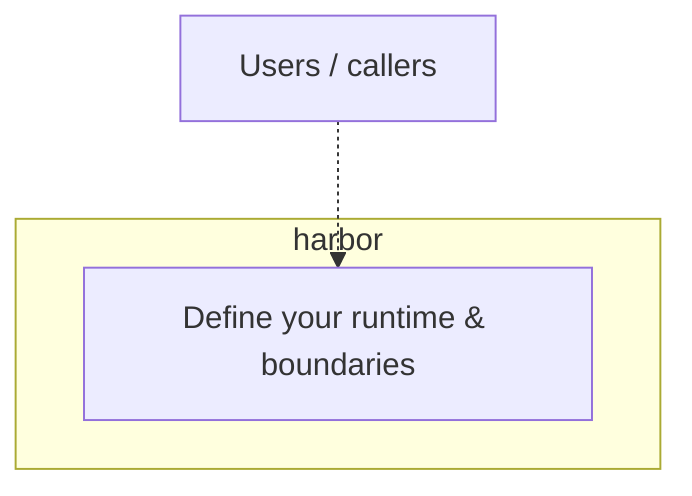

# harbor — Architecture

## Overview

This repository was scaffolded as an **empty** component. Document the real architecture here as soon as you introduce code, services, or dependencies.

## Starter diagram

When you have clarity on components and data flows, replace this with an accurate Mermaid diagram.

## Conventions

* Prefer Mermaid for diagrams (see [.dev/libs/markdown.md](../libs/markdown.md)).
* Link to runbooks, ADRs, or specs under `.dev/specs/` when relevant.
