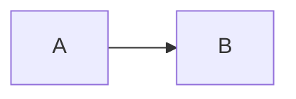

# Markdown

## Rules (enforced by markdownlint)

| Rule | Requirement |
|------|-------------|
| List markers | Use `*` only, not `-` |
| Block elements | Blank line before/after lists, code blocks, tables |
| Headings | Use `#` syntax, not `**bold**` as headings |
| Code blocks | Always specify language (use `text` for plain output) |

## Conventions

| Convention | Requirement |
|------------|-------------|
| Diagrams | Use Mermaid, not ASCII art |

## Example

````markdown
Some text.

* List item (use * not -)
* Another item

#### Subsection (use heading, not **bold**)

```python
code_with_language()
```

| Col A | Col B |
|-------|-------|
| 1     | 2     |


````

## Mermaid diagram types

* `flowchart` / `graph` — Flow diagrams
* `sequenceDiagram` — Sequence diagrams
* `classDiagram` — Class diagrams
* `stateDiagram-v2` — State machines
* `erDiagram` — ER diagrams
